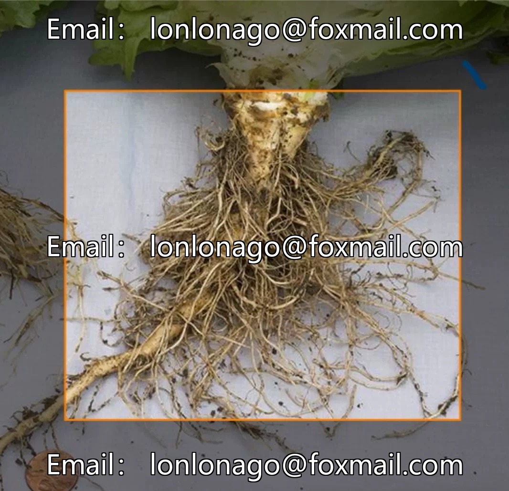
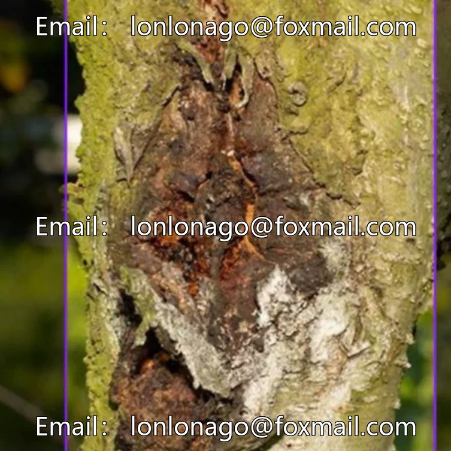
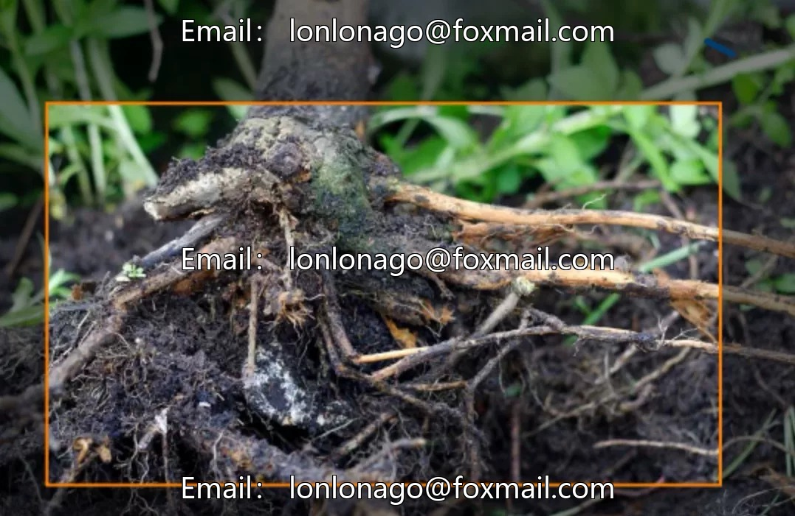
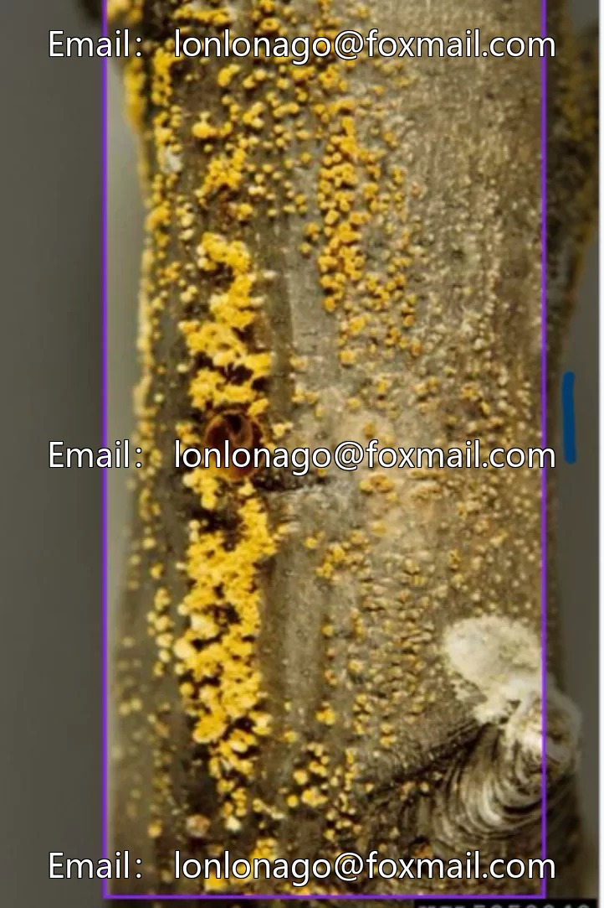
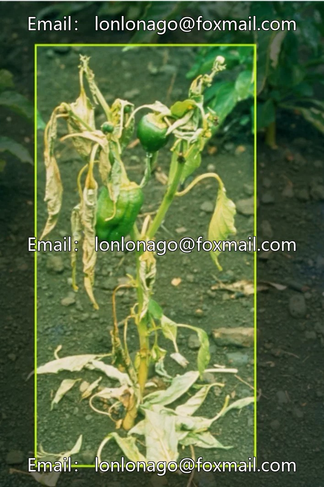
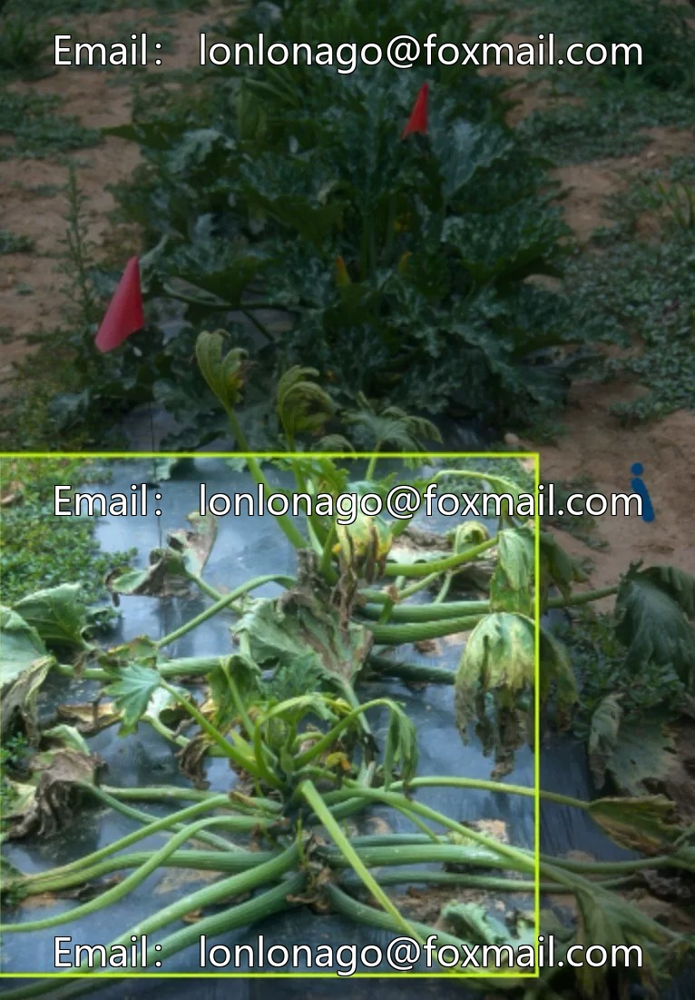

# Plant disease dataset

## Body

Plant Disease Dataset
Plant root disease identification, plant leaf disease dataset, agricultural pest and disease target detection dataset, with 10 categories precisely covering common agricultural diseases such as Asian citrus mealybug and water-soaked rot.

The dataset consists of 1,167 images across three datasets and one model, suitable for target detection tasks. The categories include: Asian Citrus Psyllid (Asian citrus aphid), Bacterial Wilt (Phytophthora infestans), Brown Planthopper (Nilaparvata lugens), Chestnut Blight (Cercospora cerasi), Corn Leafhopper (Aleyrodidae sp.), Glasshouse Whitefly (Bemisia tabaci), Leaf Scrotch (Septoria nodorum), Spotted Cucumber Beetle (Dysdercus faberi), nematode.

The data format is an image file, and the annotation files are stored accordingly. It supports mainstream computer vision tasks, has sufficient quantities, and is categorized finely, suitable for model training and testing, enhancing the efficiency of pest and disease identification.

Virtual materials, once sold, are non-refundable.
Interested friends, click "I want" to proceed.

## Images

## Payment

Here is a pay link on Stripe ( https://buy.stripe.com/3cs8yP7sY87d0vu9AB ). Please contact me lonlonago@foxmail.com after funding $89, and I will send you a complete data files , thank you!

